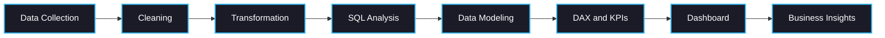

# Jagan Ambati

### Data Analyst | Business Intelligence

*Turning raw data into clear, decision-ready insights*

 

---

## About Me

I'm a **Data Analyst at iLogitek Business Solutions, Bengaluru**. I build clean, reliable dashboards and reports that help teams make better decisions.

| | |
|---|---|
| **Focus** | Dashboards, data cleaning, KPI reporting, business insights |
| **Strengths** | Data validation, data modeling, stakeholder-ready reporting |
| **Learning** | Advanced DAX, Advanced SQL, BigQuery |
| **Based in** | Bengaluru, India |

---

## Tech Stack

---

## My Analytics Workflow

---

## Featured Projects

| Project | Description | Tools | Link |
|---|---|---|---|
| **Salesman Performance Dashboard** | Sales trends, target achievement, revenue, customer acquisition and regional performance | Excel | [View](https://github.com/Ambati4422/Salesman-performance-dashboard-excel-) |
| **DAX Visualization in Power BI** | Sales performance dashboard with trends, targets and city-wise distribution | Power BI, DAX | [View](https://github.com/Ambati4422/Dax-visualization-in-power-bi) |
| **Data Modeling in Power BI** | Star-schema data model with relationships built for reporting | Power BI | [View](https://github.com/Ambati4422/Data-modeling-in-powerbi) |
| **Healthcare Data Analysis** | Cleaned and transformed healthcare data to find trends and improve data quality | Excel | [View](https://github.com/Ambati4422/Health-care-data-analyis) |
| **Excel Functions Assignment** | SUM, COUNTIF, SUMIF, IF, LEFT, RIGHT, MID applied to real data | Excel | [View](https://github.com/Ambati4422/Excel-functions-Assignment-1) |
| **Excel Data Cleaning** | Data cleaning and preparation workflow | Excel | [View](https://github.com/Ambati4422/ECXEL-ASSIG-DATA-CLEANING) |

<b>More case studies</b>

 

- **Digital India Performance Dashboard** (Excel, Power BI, DAX): KPI tracking on internet usage and digital adoption
- **HRMS Market Analysis** (Excel, SQL, Power BI): competitive analysis of HRMS/HCM companies, categories and pricing
- **Mobile Accessories Demand Analysis** (Excel, Power BI): product demand, shop-level sales and profitability
- **Hotel Management Analytics** (Python, SQL, Power BI): data cleaning, analysis and dashboards

---

## Analytics Toolkit

| Category | Tools |
|---|---|
| Spreadsheet | Excel |
| BI and Visualization | Power BI, Tableau |
| Database | SQL, BigQuery |
| Programming | Python (Pandas, NumPy) |
| Visualization Libraries | Matplotlib, Seaborn |

---

### Let's connect

I'm open to data and analytics opportunities and collaborations.

*"Turning data into insights, one dashboard at a time."*

